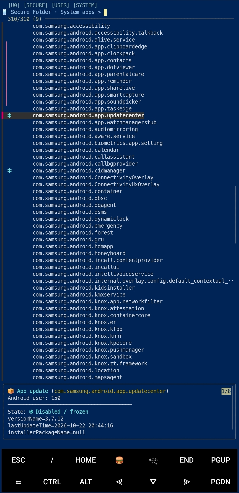
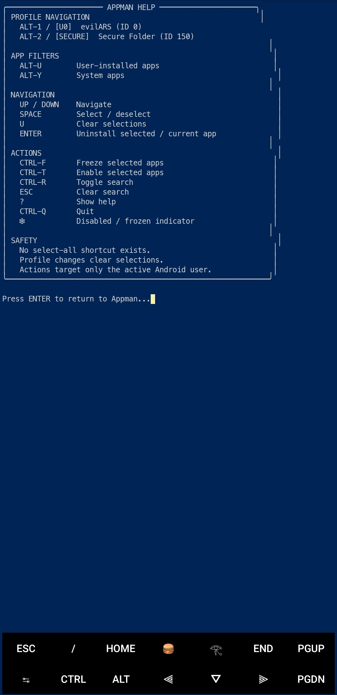
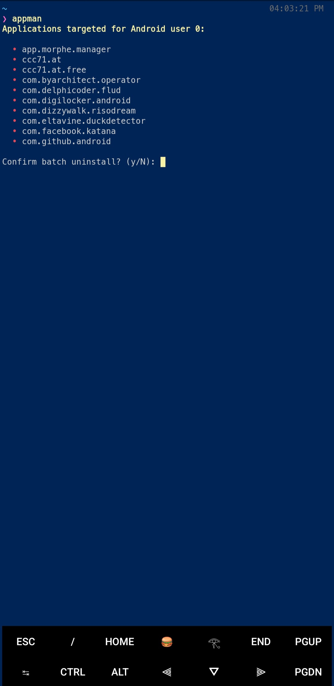

# Appman

**A terminal-based Android application manager for rooted devices.**

Appman provides an interactive interface for managing apps, profiles, and package states.

## Features & Requirements
- Dynamic Android user, profile, and app views (User/System).
- Freeze, enable, and per-user uninstall operations.
- **Requirements:** Android with root access, Termux, `fzf`, a working root-capable `sudo` command, and optional `aapt2`.

## Installation
```bash
git clone https://github.com/royalewhite/Appman.git
cd Appman
./appman
```

## Global Access

To run Appman from any directory in Termux, link it to your system binaries:

```bash
ln -s "PWD/appman" PREFIX/bin/appman
```

Now you can launch it from anywhere simply by running `appman`.

## Keyboard Controls & Safety
- **ALT-1 to 9 / Headers:** Switch profiles or filters | **ALT-U / ALT-Y:** User/System apps
- **SPACE / U:** Select/deselect or clear | **ENTER / CTRL-F / CTRL-T:** Uninstall, freeze, or enable
- **CTRL-R / ESC / ? / CTRL-Q:** Search controls, help, and quit
- *Safety:* Actions target only the active user; batch uninstalls require confirmation; uninstalls do not remove underlying system APKs.

## Compatibility & Contributions
- Tested on Samsung Galaxy M14 5G (Android 15 / One UI 7, Termux, root).
- Contributions and bug reports welcome via GitHub Issues.

## Screenshots
<p align="center">
  
  
  
</p>
